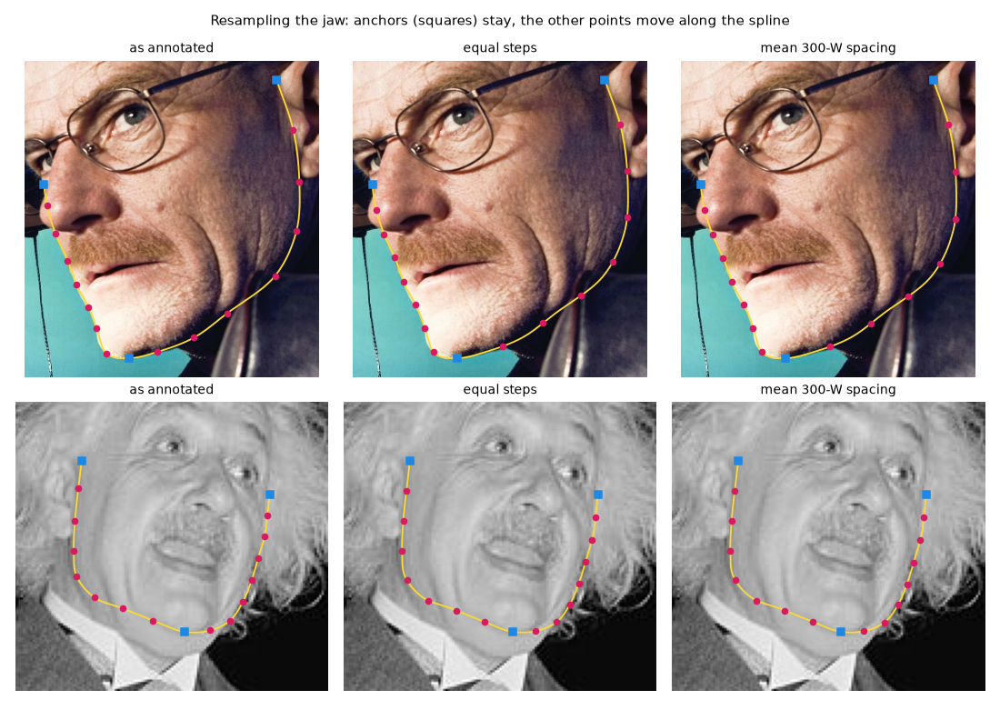

.. _menpo-shape-CatmullRom:

.. currentmodule:: menpo.shape

CatmullRom
==========
.. autoclass:: CatmullRom
  :members:
  :inherited-members:
  :show-inheritance:

Resampling a jaw
----------------
The jaw of two ibug68 faces that come with menpo (``breakingbad.jpg`` and
``einstein.jpg``), resampled with ``spline.resample([0, 8, 16])`` (equal steps
of arc length between the chin and the two ends) and with the mean fractions
of the 300-W annotators as ``spacing``. The squares are the anchors. The
figure is made by ``docs/figures/resampling.py``.

